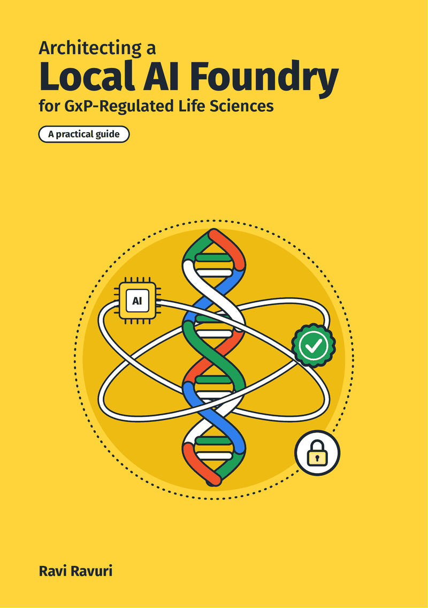

# Architecting a Local AI Foundry for GxP-Regulated Life Sciences

A practical guide by Ravi Ravuri. First edition, November 2026.

**[Download the book (PDF, 144 pages)](https://github.com/rkravuri/local-ai-foundry-book/releases/latest/download/Architecting-a-Local-AI-Foundry-for-GxP-Regulated-Life-Sciences.pdf)**

This link always gives the newest version of this edition. Every version is on the [Releases](https://github.com/rkravuri/local-ai-foundry-book/releases) page, and the [change list](CHANGELOG.md) says what changed.

## What the book is about

Most regulated companies start AI one product at a time. Each team picks a model, builds its own search index, and keeps its own logs. Then an inspector asks which document version the system read, who was allowed to see it, and who reviewed the output. Nobody can answer the same way twice.

This book describes the alternative: a single shared, self-hosted platform that every product uses, designed so that each of those answers comes from a record. The book calls that platform a Local AI Foundry.

Two things make this harder than an ordinary platform project. The platform has to be local: self-hosted, able to run with no outside connection, and in full control of its data. And it has to be acceptable in a regulated setting, where an inspector may ask how any output was produced.

Several commercial products also have Foundry in their names. The book has no connection with any of them. Here the word names a design.

## Who it is for

The book is for the people who have to stand up shared AI capability in a regulated life-sciences organization: heads of architecture, CTOs, and engineering leaders, together with their partners in Quality, Validation, and Security.

It assumes you know what a language model and a vector index are. A glossary at the end defines the terms from the regulated world and from AI engineering.

## What is inside

| Part | Chapters |
|------|----------|
| **I. Foundations** Why a shared platform is worth building, what local means, which rules apply in late 2026, and the design principles that follow from them. | 1. Why a foundry 2. What "local" means 3. The rules in late 2026 4. From rules to design |
| **II. Architecture** Three planes, eight layers, and the path of one request from sign-in to record. | 5. The reference architecture 6. The life of a request |
| **III. Knowledge** How approved documents become governed data, and how the platform finds, cites, and sometimes declines to answer. | 7. Documents as governed data 8. Retrieval you can defend |
| **IV. Assurance** Validation for a system that varies, evaluation that produces evidence, and change control for everything that can move. | 9. Validating a system that does not repeat itself 10. Evaluation as evidence 11. Change control |
| **V. Protection** What has gone wrong in practice, how to defend against it, and who decides what under privacy law and the EU AI Act. | 12. Threats and defenses 13. Privacy, the EU AI Act, and governance |
| **VI. Operations** What to run and on what, what it costs, and how to run it from the first day. | 14. Models, hardware, and hosting 15. Cost and return 16. Running it, and the first ninety days |

Every chapter ends with a box called "Decisions to record". Appendix A is a checklist to run before the platform goes live. Appendix B collects all the decisions into one register. Sources are listed at the end of each chapter.

## What it does not cover

- It is not an installation guide, and it contains almost no code.
- The rules chapter and the examples come from manufacturing and quality work under GMP. Clinical trials (GCP), laboratory studies (GLP), and drug safety (pharmacovigilance) have rules of their own that this edition does not cover.
- It does not cover structured data in laboratory information management systems (LIMS) or manufacturing execution systems (MES). The platform in the book works on controlled documents and on the records kept in document and quality systems.

## Dates, sources, and limits

The status of every regulation, standard, product, and price in the book was checked on 21 November 2026. Several of the rules are drafts, and they will change. Check the sources before you rely on a date.

The book is a technical guide. It is not legal or regulatory advice.

## How to cite

Ravi Ravuri. *Architecting a Local AI Foundry for GxP-Regulated Life Sciences: A Practical Guide.* First edition, November 2026. https://github.com/rkravuri/local-ai-foundry-book

## Copyright and sharing

Copyright © 2026 Ravi Ravuri. All rights reserved.

You may share the complete, unmodified PDF. For any other use, ask the author.

The views in the book are the author's own. They are not the views of any employer, past or present.

This repository holds the released book only. It has no open-source license.

## About the author

Ravi Ravuri is a product and technology leader in enterprise software, GxP systems, and local AI. He has more than 25 years in enterprise software and is based in Hyderabad, India. Connect on LinkedIn: [linkedin.com/in/raviravuri](https://www.linkedin.com/in/raviravuri).
